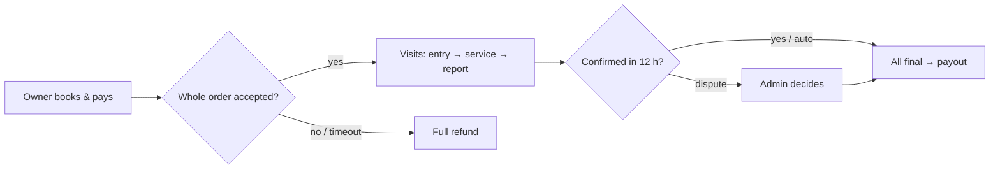

# PawPal: Project Brief for Planning & Development

**Product:** PawPal (home pet-care booking platform)
**Owner:** KF Lee
**Document purpose:** The single source for planning and building PawPal with Claude.
**Date:** 24 Oct 2026 · **Version:** 1.1
**Status:** Coding started. E1-1, E1-2 done. v1.1 adds 9 stories to make PawPal sell-ready (KF, 24 Oct). Wireframes V0.2 (56 views).

---

## 0. Instructions for Claude (read first)

You are helping build **PawPal**: pet owners in **Kuala Lumpur** book vetted caregivers to visit their home and care for cats and dogs. Three parts: **owner app** and **caregiver app** (one mobile web app, role switch) plus a **web admin console**. Read this whole brief and `CLAUDE.md` first.

**Working rules:**
- **No code until KF confirms the whole plan.** Then build story by story (section 8), testing each one.
- Every round: review this brief and ask KF about anything unclear (section 10).
- Section 2.4 rules are **settled**. Section 9 items are **TBD**: never invent them.
- Ask KF before any expensive-to-change decision.
- This brief is the only planning document. Update it; do not create extra docs.
- Keep explanations short, plain and neat.

---

## 1. Business Context

| Item | Detail |
|---|---|
| Market | Pet owners in Kuala Lumpur, Malaysia (one-city pilot) |
| Currency | RM |
| Service | Home visits: feeding, water, litter, walks, photo report. Multi-day, multi-visit bookings |
| Supply | Independent caregivers, approved by the platform |
| Revenue | Platform keeps 15% of service and overtime fees |
| Source | Page list V0.1 (`docs/pages/`). No separate PRD file; this brief replaces it |

---

## 2. Product Requirements

### 2.1 General

| # | Requirement |
|---|---|
| G1 | One mobile web app, two roles. Owner by default; approved caregivers switch role. Switching never changes order ownership. Nobody accepts their own order. |
| G2 | Separate web admin console with its own accounts and permissions. |
| G3 | Pay-in: Touch 'n Go, DuitNow, FPX, cards via a gateway. Fake gateway until chosen. |
| G4 | Automatic payouts to caregivers when an order is fully settled. |
| G5 | Booking, visit, report, payment, refund, payout are separate statuses. Never one "Completed". |
| G6 | Pay, refund, payout are idempotent: repeats never take effect twice. |
| G7 | Payment results come from the gateway callback, never the front end. |
| G8 | PDPA: address, entry instructions, income visible only to authorised users; never in notification text. |
| G9 | Audit trail: every status change records who / when / why. Admin changes need a reason. |
| G10 | Prices and limits live in one place (`codes/shared/` + admin rules page), versioned. |

### 2.2 Owner (O01–O21)
Pet profiles → addresses → booking (pets, service, dates, visits per day, overtime, address) → choose caregiver → entry method → confirm → pay in full → track order and visits → cancel → refunds → confirm report or dispute → approve waiting/overtime → approve substitute → review (reserved).

### 2.3 Caregiver (S01–S16) and Admin (A01–A15)
- **Caregiver:** apply → review → profile, area, schedule → accept whole order or reject → entry → service → photo report → exceptions, waiting/overtime → income and settlement.
- **Admin:** dashboard queues, caregiver review, pet check, orders, exceptions and substitutes, disputes, money queue, rules with history.

### 2.4 Settled Business Rules (do not change)

| Item | Rule |
|---|---|
| Price | Cat RM40 / ≥30 min (one level only) · Dog basic RM60 / ≥20 min · Dog upgrade RM70 / ≥60 min |
| Mixed | Dog price + RM10 per cat · 2nd dog +RM10 · basic ≥45 min · upgrade ≥60 min |
| Extras | Extra pet RM10 each · Overtime RM10 per 15 min |
| Capacity | Max 3 pets, max 2 dogs |
| Accept window | First visit <3 h away at payment: fail, full refund · 3–6 h: urgent, 30 min · ≥6 h: normal, 3 h |
| Accepting | Whole order only · no slot held while pending · cancel beats accept |
| Cancel refund | ≥24 h 100% · 1 h to <24 h 80% · <1 h 0% (exactly 24 h = 100%, exactly 1 h = 80%) · from formal submit time · normal unstarted visits only |
| Waiting | From booked start · first 10 min free · RM5 per started 10 min (11 min = RM5) · max 60 min / RM25 · 100% to caregiver · unused prepay refunded |
| No handover (owner fault) | Visit fee kept, 50/50 split, no extra cancel fee |
| Split | Service + overtime: caregiver 85%, platform 15% |
| Report | Min 3 photos · complete photo report starts 12 h confirm window per visit · dispute freezes whole-order payout |
| Rounding | Round to the nearest sen |
| Price version | Order uses prices at payment time; rule changes affect new orders only |
| Unused overtime | Unused 15-min units refunded |
| Senior pet | Cat ≥ 12 yrs, dog ≥ 8 yrs → admin check |
| Caregiver check | IC verification required; good-conduct certificate optional |
| Pet not as declared (after accept) | Admin decides case by case |
| Caregiver suspended | Remaining visits: substitute (owner approves) or full refund |
| Deadline vs accept (same second) | Deadline wins: order fails, full refund |
| Payment unknown | Show "checking"; re-query gateway every minute for 30 min, then admin queue |
| Free waiting | Stops at real handover; full 10 min need not be used |
| Late caregiver | Waiting counts from booked start only; late > 15 min → owner may report |
| Report edits | Not allowed after submit; add notes via a case |
| Data retention | Orders 7 years; photos deleted after 1 year |
| Substitute costs more | No extra charge to owner; platform covers difference |
| Not in MVP | Rescheduling (cancel + rebook instead); multi-city setup (after pilot) |
| Reviews | In MVP (O21, E9-3) · owner, once per order, after all visits final · caregiver may reply once · admin may hide abusive ones with reason |
| GPS check | Location only at entry and finish · > 500 m from address → flag to admin (not blocked) |
| Promo code | Platform pays the discount; caregiver still gets 85% of full price · one code per order |
| Referral | RM10 credit to both after the friend's first order is settled |
| Brand | B · Trusted Teal (KF, 25 Oct): teal #1F9E89, Poppins font, house-and-paw logo · options in `design/brand/options.html` · defined only in `codes/shared/src/brand.ts` |
| Insurance note | Shown only if a real policy is in place (E15-5) |
| Service hours | Visits start between 7:00 am and 10:00 pm |
| Booking range | Up to 60 days ahead · max 20 days per order · max 3 visits per day |
| Extra pets & time | Extra pets do not extend the minimum time |
| Caregiver fault / no-show | Owner gets full refund of that visit; caregiver gets nothing; repeated → admin may suspend |
| Cancel with booked overtime | Overtime refunded at the same % as the visit |
| Travel buffer | Default 30 min between visits; caregiver can change |
| Payout | Only when every visit is final, no open dispute, refunds closed · "paying" ≠ "paid" |

---

## 3. Key Flows

| # | Flow | Path |
|---|---|---|
| F1 | Book & pay | O06 → O07 → O08 → O09 → O10 → O11 → O13 pending accept |
| F2 | Accept / fail | S07 accept whole order → booked · reject / timeout / withdraw → full refund · rebook = new order |
| F3 | Visit | S09 → S10 entry → S11 service → S12 report → O17 confirm or 12 h auto |
| F4 | Cancel | O15 per-visit preview → submit → per-visit result → O16 refund |
| F5 | Waiting / overtime | S14 request → O19 approve → O11 pay → continue · unpaid = not done |
| F6 | Exception / substitute | O18/S13 → A09/A10 → O20 owner approves · no deal → affected visits refunded |
| F7 | Dispute | O17 → O18 → A11/A12 → A14 · whole-order payout frozen |
| F8 | Settlement | All conditions met → auto payout → S16 paying → paid · failure → A13/A14 |

---

## 4. Domain Model

### 4.1 Objects

| Object | Notes |
|---|---|
| User | One account; roles owner, caregiver (after approval). Admin users separate |
| Pet | Status: approved / pending check / needs info / rejected |
| Address | Contacts; entry instructions encrypted |
| Order | One booking, one caregiver, many visits; keeps rule version used |
| Visit | Own status, times, entry record, report, fees |
| Report | Photos + checklist; submit time starts 12 h window |
| ExtraFee | Waiting or overtime: request → approve → pay → use → refund difference |
| Payment / Refund / Payout | Separate ledgers, idempotency keys, gateway refs |
| Case | Exception or dispute; evidence, decision, linked money actions |
| RuleVersion | Prices and limits with effective date |
| StatusHistory | Every status change of every object |

### 4.2 Statuses

| Object | Statuses |
|---|---|
| Order | pending_payment → pending_accept → booked → closed · failed · withdrawn |
| Visit | scheduled → arrived → in_service → report_submitted → confirmed · cancelled · no_handover · disputed · refunded |
| Payment | pending · paid · failed · unknown (checking) |
| Refund | processing · succeeded · failed |
| Payout | processing · paid · failed |
| ExtraFee | requested · awaiting_payment · paid · rejected · settled |
| Case | open · awaiting_evidence · resolved |

### 4.3 IDs and Money
- IDs: ULID. Display numbers: `PP-20261028-0001` (order), `V-`, `R-`, `PO-`.
- Money: integer **sen** (RM1 = 100). Never floats.
- Idempotency key on every pay / refund / payout.
- Audit fields on every table: `created_at, updated_at, created_by`.

---

## 5. Technical Decisions

| Topic | Decision | Status |
|---|---|---|
| Mobile | uni-app (Vue 3, TS), H5 mobile web first; Android/iOS later | Agreed |
| Admin | Vue 3 + Vite + Element Plus | Agreed (UI kit proposed) |
| Backend | Node.js + NestJS (TS), modular monolith | Agreed |
| Database | PostgreSQL 17 + Redis | Changed from MySQL by KF (25 Oct) |
| Timers | Server-side; deadlines re-checked when fired; cancel beats accept via row lock | Agreed |
| Payment | Gateway adapter (`charge`, `refund`, `payout`, `webhook`); fake adapter first. Shortlist: Fiuu, HitPay, Xendit (Stripe out: no TnG) | **KF to contact providers** |
| Hosting | AWS Malaysia or Alibaba Cloud KL; data in Malaysia | **Left open** |
| Login | Phone + SMS code only (6 digits, valid 5 min, resend after 60 s, max 5 per hour, 5 wrong tries kills the code); first login creates the account; login lasts 30 days; mock code shown on screen in development; SMS provider chosen before pilot | Built (E2-1) |
| Notifications | Web push to every device the caregiver turned on + WhatsApp (SMS if WhatsApp fails) for new requests; reminder 10 min before the deadline; each alert also in Messages; no address; caregiver can turn WhatsApp/SMS off; iPhone push only after Add to Home Screen; WhatsApp provider mock until chosen | Built (E2-5) |
| Support contact | WhatsApp help button on Me (and on order pages from E7-2); text is "Hi PawPal, I need help." or "…with order #P…", nothing else; number from SUPPORT_WHATSAPP in server settings, shown on admin Rules; real number not given yet (placeholder +60 12-345 6789 outside production) | Built (E2-6) · number open |
| Pet profile | Cat/dog, name, birth month+year, vaccinated yes/no + optional card photo (record valid 12 months), health note; dogs also breed (list + Other) and weight 1–90 kg; owner confirms info is true; senior / no or old vaccine record / health note → admin check, only admin rejects; photos on server disk in development | Built (E3-1) |
| Pet status | Approved / pending check / needs info / rejected; needs info and rejected show the admin's reason; pending and needs info: draft yes, pay after approval; rejected: cannot be chosen; owner update after needs info → pending again; rejected stays rejected | Built (E3-2) |
| Pet check (admin) | Queue of pending + needs-info pets; decision approve / needs info / not accepted; reason required except approve; owner gets a message; every decision in status history; admin-approved pet is re-checked only when age, vaccine, health note, type, breed or weight changes | Built (E3-3) |
| Addresses | Area from shared list + street, unit, postcode; contact + phone required, emergency optional; max 5, one default; street/unit/postcode/contacts encrypted (ADDRESS_KEY); no entry instructions stored; soft delete | Built (E3-4) |
| Caregiver application | One per account; Malaysian IC only (YYMMDD checked, 18+); IC front/back + selfie with IC required, up to 3 certificates and 1 good-conduct optional; dog takers pick largest size (small <10, medium 10–25, large >25 kg); IC number encrypted, photos private; draft on server; submit locks it and makes the account Under review; care guide version must be read again when it changes | Built (E4-1) |
| Caregiver review (admin) | Queue filters Waiting / Needs info / Approved / Not approved; Approve needs the IC match tick; Needs info / Not approved need a 5+ character reason sent to the caregiver; IC masked, each Show recorded; same approved IC on another account blocks approval; rejected applicants may resubmit | Built (E4-2) |
| Review result (S03) | Status page after sending: status, date sent, reason, 1–3 working days while waiting; Fix my application / Switch to Caregiver + next steps; Me row until approved; caregiver-only actions refused on the server unless approved | Built (E4-3) |
| Caregiver profile (S04) | Instant: areas, experience, intro ≤ 300, lowering ability; review: adding dogs, larger size, new photo (old values used until approved); one pending change; display name "First L."; name/IC via support | Built (E4-4) |
| Caregiver schedule (S05) | Free 7 am–10 pm by default; one-off and weekly "Not available" blocks; travel buffer 15/30/45/60 (default 30) around booked visits; overtime limit 0/15/30/45/60 (default 30); booked visits locked; 60-day list | Built (E4-5) |
| Verified badge & insurance (O08) | "✓ ID verified" for approved caregivers (IC + selfie checked); "✓ Certificate checked" if admin ticked it; insurance note from one admin Rules switch + note ≤ 150, off by default; O08 shows display name, photo, experience, areas, pets, intro, badges, never contact details | Built (E4-6) |
| Booking setup (O06) | One level per order; same overtime 0–60 min per visit; ≤ 20 dates within 60 days, 1–3 non-overlapping visits per date, start 7 am–10 pm in 30-min steps, first ≥ 3 h away; server draft (one per owner), price locked at payment; checking pets allowed (pay waits), rejected hidden; "Book now" on O01 | Built (E5-1) |
| Choose a caregiver (O07, O08) | Listed: approved, works in the address's area, takes every pet (dog weight ≤ size limit), overtime ≤ her limit; availability from blocks + booked visits + buffer; free first then experience; clashing greyed, not choosable; choice kept in the draft, cleared with a note if she no longer fits; nobody fits → "Change my booking", no auto-assign | Built (E5-2) |
| Entry method (O09) | Pre-authorised (default) or Live confirm; Key or lock / Guard or reception / Other notes ≤ 300 each, Key or lock required for Pre-authorised; encrypted, owner only until the caregiver accepts; never in notifications, not for admins; saved per booking in the draft | Built (E5-3) |
| Confirm and pay (O10) | Shows caregiver, visits, entry method, total, cancel policy; health tick required; server re-checks everything before paying (pets must be approved); order P+date+3 digits with prices locked; draft cleared on success; failed → retry same order; editing cancels the unpaid order; test-payment page via mock gateway | Built (E5-4) |
| Payment result (O11) | Paid: amount, order number, caregiver, waiting for accept + deadline (3 h, or 30 min when first visit < 6 h); checking: poll 3 s for 2 min then "we will message you", pull to refresh; failed: reason + retry same order; paid when first visit < 3 h away → order fails, full refund; in-app message on payment and refund; extra fees use O11 in E11 | Built (E5-5) |
| Promo codes (O10, admin) | RM off or % off with optional cap; dates, total uses, min spend, once per owner, optional first order only; applied on O10 and re-checked at Pay; use counted on payment, given back on cancel / fail / full refund; refunds based on the discounted amount per visit; platform pays the discount, caregiver 85% of full price; admin page with history; total ≥ RM1 | Built (E5-6) |
| Invite friends (C03, O10) | Personal code + link on Me (Copy, WhatsApp); new accounts only, via link or code at sign-up; self-invite and old phone numbers blocked; RM10 credit to both when the friend's first order is settled (Test tools until E8/E9); credit used automatically on O10 with promo codes, total ≥ RM1; refunded credit returns as credit; lasts 12 months; PawPal pays | Built (E5-7) |
| Caregiver requests (S01, S06) | Only the chosen caregiver; S01 card + S06 list; tag, time left, first visit, visits, area, pets, income 85%; urgent = 30-min window; at 0 → History "Expired" (30 days); real alerts on payment + 10-min reminder; detail page, accept in E6-2; paused caregiver sees reason only | Built (E6-1) |
| Accept or reject (S07) | Whole order only, every visit checked against schedule, clashes listed; deadline wins at the same moment; accept → Booked, visits locked in schedule, owner told; caregiver then sees address + contact (entry details E8-2); reject with reason → full refund at once, promo and credit back, owner told without reason; History Accepted / You said no; no penalty | Built (E6-2) |
| Deadlines (O11, S06) | Check every 30 s; past deadline → failed + full refund, promo and credit back; owner and caregiver messages; owner page live countdown, at 0 Not accepted; test tool expires and refunds at once | Built (E6-3) |
| Withdraw (O11, S06) | Owner withdraws while waiting: confirm popup, no reason, full refund, promo and credit back; caregiver told "Owner withdrew"; one of withdraw/accept wins | Built (E6-4) |
| Book again (O11, O06) | After a failed, refused, timed-out or withdrawn order: copies pets, level, extra time, address, visits, entry; not caregiver or promo; past visits left out with a note; asks before replacing a booking in progress; new order, old refund separate | Built (E6-5) |
| My orders (O12) | Me → Owner + home link; filters All / Waiting / Booked / Ended; paid orders only; card with number, visits, tag, paid, one status line; newest first, 20 per page; empty + Book now, error + Retry | Built (E7-1) |
| Order details (O13) | From My orders and messages; number + copy, caregiver, tag, live status line; every visit with time, length, price and status; money box + separate refund row (on its way / refunded); Withdraw / Book again / WhatsApp help; pets, address, entry | Built (E7-2) |
| Visit details (O14) | From O13; date, planned time, service, caregiver, entry, visit price and paid; actual time / handover / report "After the visit" until E8; status as O13; Help button now, Cancel/Report/Problem buttons with E10/E9/E12 | Built (E7-3) |
| My tasks (S08) | Home card + Me → Caregiver; 14-day date row with counts; task time, status, area, pets, length, order number; gap line, red when under the buffer; accepted-order visits only; cancelled greyed; empty "No tasks on this day." | Built (E8-1) |
| Visit (S09) | From S08; time, status, service, number + copy, income; pets with health note; entry method always, instructions 2 h before to end (logged, not when cancelled); address + contact with Call; start button placeholder until E8-3 | Built (E8-2) |
| Confirm entry (S10, O14) | Visit status To do → Arrived → In service; Arrived from 30 min before (no clock); Pre-authorised: tick + Confirm entry; Live confirm: owner confirms on O14 after an arrival message; O14 shows arrived/entered times and who confirmed; Test tool moves a visit to start in 10 min | Built (E8-3) |
| Record service (S11) | Opens after entry; served time vs minimum; checklist from pets (feed, water, litter for cats, walk for dogs) saved per tick; up to 9 photos saved at once, deletable; finish under minimum asks first; overtime and problem buttons later | Built (E8-4) |
| Languages | English + Chinese (Malay later) | Decided |
| Service area | Caregiver picks areas from one list shared with owner addresses: 12 KL areas + Petaling Jaya (R11-2); admin edits later (E14) | Decided (KF, 29 Oct) |
| Team | KF + Claude; coding starts only when KF says start | Decided |
| Admin roles | One admin role with full access for the pilot; split roles later | Decided |
| Admin login | Username + password (10+ chars) + authenticator-app code (TOTP); 5 wrong tries → locked 15 min; session 12 h; each code works once; first admin via `pnpm admin:create`; per-page permissions (pilot: all pages) | Decided (KF, 27 Oct) |
| Wireframes | Update each page to the latest rules when its story is built | Decided |
| Why no WeChat | WeChat Pay stopped in Malaysia (Sep 2024) | Decided |

**Folders:** `docs/` (this brief, page list) · `design/wireframes/` (56 views, open `index.html`) · `codes/` (`mobile`, `admin-web`, `server`, `shared`, `tests`, `scripts`).

---

## 6. Wireframes

| Area | Views |
|---|---|
| Common | C01 login · C02 messages · C03 me · C04 role switch |
| Owner | O01 home · O02–O05 pets, check, addresses · O06–O11 booking to payment · O12–O16 orders, visits, cancel, refund · O17–O21 report, case, extra fee, substitute, review |
| Caregiver | S01 dashboard · S02–S05 apply, profile, schedule · S06–S08 requests, tasks · S09–S14 visit execution · S15–S16 income |
| Admin | A01–A02 login, dashboard · A03–A06 reviews · A07–A08 orders · A09–A14 exceptions, disputes, money · A15 rules |

---

## 7. Non-Functional Requirements

- Deadlines exact and server-side (accept, 12 h, waiting cap).
- No double booking of caregiver time; cancel beats accept.
- OWASP top 10, encryption in transit / at rest, PDPA.
- Automated tests for pricing, refunds, transitions, settlement; the 9 walk-throughs (8.2) as end-to-end tests.
- Logs and alerts for payment / payout failures.

---

## 8. Epics & Stories

Format: **ID · Story · Done when · Views · Est. · Test.** Build in epic order.

### 8.0 How We Work on Stories

MVP first, test-driven. **One story per round**, in this order:
1. **a. Backend** code
2. **b. Backend tests** (automated scripts)
3. **c. Frontend** code
4. **d. Frontend tests** (automated, Playwright)
5. **e. KF tests by hand** and approves

A round ends only when backend and frontend have **0 errors and 0 warnings** (`pnpm check` + `pnpm e2e`). Then the next story. Every round: review this brief and ask KF about anything unclear (section 10). Estimates are working days for KF + Claude.

**Progress**
| Story | Status | Date |
|---|---|---|
| E1-1 | ✅ Done · automated tests 0 errors 0 warnings · KF hand test passed | 24 Oct 2026 |
| E1-2 | ✅ Done · automated tests 0 errors 0 warnings · KF hand test passed | 24 Oct 2026 |
| E1-3 | ✅ Done · automated tests 0 errors 0 warnings · KF hand test passed | 24 Oct 2026 |
| E1-4 | ✅ Done · automated tests 0 errors 0 warnings · KF hand test passed (on PostgreSQL) | 25 Oct 2026 |
| E1-5 | ✅ Done · automated tests 0 errors 0 warnings · KF hand test passed | 26 Oct 2026 |
| E2-1 | ✅ Done · automated tests 0 errors 0 warnings · KF hand test passed | 26 Oct 2026 |
| E2-2 | ✅ Done · automated tests 0 errors 0 warnings · KF hand test passed | 26 Oct 2026 |
| E2-3 | ✅ Done · automated tests 0 errors 0 warnings · KF hand test passed | 26 Oct 2026 |
| E2-4 | ✅ Done · automated tests 0 errors 0 warnings · KF hand test passed | 27 Oct 2026 |
| E2-5 | ✅ Done · automated tests 0 errors 0 warnings · KF hand test passed | 27 Oct 2026 |
| E2-6 | ✅ Done · automated tests 0 errors 0 warnings · KF hand test passed (order page button placed when O13 is built in E7-2) | 28 Oct 2026 |
| E3-1 | ✅ Done · automated tests 0 errors 0 warnings · KF hand test passed | 28 Oct 2026 |
| E3-2 | ✅ Done · automated tests 0 errors 0 warnings · KF hand test passed (payment block applied when booking is built, E5) | 28 Oct 2026 |
| E3-3 | ✅ Done · automated tests 0 errors 0 warnings · KF hand test passed | 29 Oct 2026 |
| E3-4 | ✅ Done · automated tests 0 errors 0 warnings · KF hand test passed (area re-check applied when booking is built, E5) | 29 Oct 2026 |
| E4-1 | ✅ Done · automated tests 0 errors 0 warnings · KF hand test passed | 29 Oct 2026 |
| E4-2 | ✅ Done · automated tests 0 errors 0 warnings · KF hand test passed | 30 Oct 2026 |
| E4-3 | ✅ Done · automated tests 0 errors 0 warnings · KF hand test passed | 30 Oct 2026 |
| E4-4 | ✅ Done · automated tests 0 errors 0 warnings · KF hand test passed | 30 Oct 2026 |
| E4-5 | ✅ Done · automated tests 0 errors 0 warnings · KF hand test passed | 30 Oct 2026 |
| E4-6 | ✅ Done · automated tests 0 errors 0 warnings · KF hand test passed (O07 list linked in E5-2) | 30 Oct 2026 |
| E5-1 | ✅ Done · automated tests 0 errors 0 warnings · KF hand test passed | 30 Oct 2026 |
| E5-2 | ✅ Done · automated tests 0 errors 0 warnings · KF hand test passed | 31 Oct 2026 |
| E5-3 | ✅ Done · automated tests 0 errors 0 warnings · KF hand test passed | 31 Oct 2026 |
| E5-4 | ✅ Done · automated tests 0 errors 0 warnings · KF hand test passed | 31 Oct 2026 |
| E5-5 | ✅ Done · automated tests 0 errors 0 warnings · KF hand test passed | 31 Oct 2026 |
| E5-6 | ✅ Done · automated tests 0 errors 0 warnings · KF hand test passed | 31 Oct 2026 |
| E5-7 | ✅ Done · automated tests 0 errors 0 warnings · KF hand test passed | 2 Nov 2026 |
| E6-1 | ✅ Done · automated tests 0 errors 0 warnings · KF hand test passed | 2 Nov 2026 |
| E6-2 | ✅ Done · automated tests 0 errors 0 warnings · KF hand test passed | 3 Nov 2026 |
| E6-3 | ✅ Done · automated tests 0 errors 0 warnings · KF hand test passed (order and request numbers copy with an icon) | 3 Nov 2026 |
| E6-4 | ✅ Done · automated tests 0 errors 0 warnings · KF hand test passed | 3 Nov 2026 |
| E6-5 | ✅ Done · automated tests 0 errors 0 warnings · KF hand test passed | 3 Nov 2026 |
| E7-1 | ✅ Done · automated tests 0 errors 0 warnings · KF hand test passed | 3 Nov 2026 |
| E7-2 | ✅ Done · automated tests 0 errors 0 warnings · KF hand test passed | 4 Nov 2026 |
| E7-3 | ✅ Done · automated tests 0 errors 0 warnings · KF hand test passed | 4 Nov 2026 |
| E8-1 | ✅ Done · automated tests 0 errors 0 warnings · KF hand test passed | 4 Nov 2026 |
| E8-2 | ✅ Done · automated tests 0 errors 0 warnings · KF hand test passed (past visits say "Hidden: the visit time has passed"; order numbers may pass 999 a day) | 4 Nov 2026 |
| E8-3 | ✅ Done · automated tests 0 errors 0 warnings · KF hand test passed | 4 Nov 2026 |
| E8-4 | ✅ Done · automated tests 0 errors 0 warnings · KF hand test passed (owner can also confirm entry on O13) | 4 Nov 2026 |

### 8.1 Schedule

| Epic | Name | Days | Working days | Weeks |
|---|---|---|---|---|
| E1 | Project Foundation | 9 | Day 1–9 | Week 1–2 |
| E2 | Accounts & Roles | 8½ | Day 10–17½ | Week 2–4 |
| E3 | Pets & Addresses | 6 | Day 18–23½ | Week 4–5 |
| E4 | Caregiver Onboarding | 9 | Day 24–32½ | Week 5–7 |
| E5 | Booking & Payment | 12 | Day 33–44½ | Week 7–9 |
| E6 | Accepting Orders | 8 | Day 45–52½ | Week 9–11 |
| E7 | Orders & Visits | 4 | Day 53–56½ | Week 11–12 |
| E8 | Visit Execution | 10 | Day 57–66½ | Week 12–14 |
| E9 | Reports & Confirmation | 5 | Day 67–71½ | Week 14–15 |
| E10 | Cancellation & Refunds | 5 | Day 72–76½ | Week 15–16 |
| E11 | Waiting & Overtime | 7 | Day 77–83½ | Week 16–17 |
| E12 | Exceptions & Disputes | 10 | Day 84–93½ | Week 17–19 |
| E13 | Settlement & Payouts | 7 | Day 94–100½ | Week 19–21 |
| E14 | Admin Operations | 6 | Day 101–106½ | Week 21–22 |
| E15 | Real Payment & Pilot | 15 | Day 107–121½ | Week 22–25 |
| **Total** | | **121½** | | **≈ 25 weeks** |

Start date: **TBD (KF)**. Week 1 = first week of coding.

### E1 · Project Foundation
| ID | Story | Done when | Views | Est. (days) | Test |
|---|---|---|---|---|---|
| E1-1 | As a developer, I want the repo set up (mobile, admin, server, shared) so all parts build and run | One command runs all; lint + tests pass | — | 2 | Fresh clone: one command installs, builds, runs all 4 parts; CI green |
| E1-2 | As the business, I want rules in one shared module so prices never differ between screens | Prices, limits, splits only in `shared`; unit tests for every rule in 2.4 | — | 2 | Unit test every row of 2.4 incl. boundaries (exactly 24 h, 1 h, 3 h, 6 h, 10/60 min) |
| E1-3 | As the business, I want a fake payment gateway so we can build before the real one | Charge / refund / payout / webhook simulated; switchable later | — | 1 | Simulate success, failure, unknown, duplicate webhook → one result only |
| E1-4 | As an admin, I want every status change logged so we can trace any problem | StatusHistory written on every change | — | 1 | Change any status → one history row with who/when/why |
| E1-5 | As the business, I want one brand look and an installable app so PawPal looks professional | Logo, colours, fonts, shared UI parts; PWA (add to home screen, app icon) | all | 3 | Every screen uses brand tokens; app installs on Android and iPhone home screen |

### E2 · Accounts & Roles
| ID | Story | Done when | Views | Est. (days) | Test |
|---|---|---|---|---|---|
| E2-1 | As a user, I want to log in with my phone number so I can book | SMS code login (mock code in development); returns to original task | C01 | 2 | Login, wrong code, expired code; returns to the page you came from |
| E2-2 | As a caregiver, I want to switch role so I use one account | Switch only if approved; order ownership unchanged | C03, C04 | 1 | Unapproved user cannot switch; switching keeps orders; cannot accept own order |
| E2-3 | As a user, I want a message centre so I see updates | Messages link to latest state; role check before opening | C02 | 2 | Message opens latest state; wrong role prompts switch; no address in message text |
| E2-4 | As an admin, I want a separate login so the back office is secure | Admin accounts separate; permission per page | A01 | 1 | App account cannot log in to admin; page without permission is blocked |
| E2-5 | As a caregiver, I want web push plus WhatsApp/SMS alerts so I never miss an urgent request | New request and deadline reminders sent on both channels; no address in message | C02, S06 | 2 | Urgent request → push + WhatsApp/SMS within 1 min; reminder 10 min before deadline |
| E2-6 | As a user, I want a WhatsApp help button so I can reach support fast | Button on Me and order pages; prefilled order number, no address | C03, O13 | 0.5 | Button opens WhatsApp with order number; no private data in text |

### E3 · Pets & Addresses
| ID | Story | Done when | Views | Est. (days) | Test |
|---|---|---|---|---|---|
| E3-1 | As an owner, I want to add pet profiles so caregivers know my pets | Cat/dog fields; dogs need breed + weight | O02, O03 | 2 | Add/edit cat and dog; dog without breed/weight cannot save |
| E3-2 | As an owner, I want to see if my pet is approved so I know I can book | 4 statuses; unapproved pets can't be booked | O04 | 1 | Each of 4 statuses shown; pending/rejected pet cannot be booked |
| E3-3 | As an admin, I want to check flagged pets so unsafe bookings are stopped | Approve / need info / reject with reason; owner notified | A05, A06 | 2 | Approve, need info, reject → owner sees result and reason |
| E3-4 | As an owner, I want to save addresses and contacts so booking is quick | Add / choose; change re-checks caregiver area | O05 | 1 | Add/choose address; change address during booking re-checks area |

### E4 · Caregiver Onboarding
| ID | Story | Done when | Views | Est. (days) | Test |
|---|---|---|---|---|---|
| E4-1 | As a caregiver, I want to apply with my documents so I can work | Required fields; draft save | S02 | 2 | Missing required field blocks submit; draft reloads |
| E4-2 | As an admin, I want to review applications so only vetted people work | Approve / need info / reject with reason | A03, A04 | 2 | Each decision notifies caregiver with reason |
| E4-3 | As a caregiver, I want to see my review result so I know what to fix | Status + reason; no accepting before approval | S03 | 1 | Not approved → no accept button anywhere |
| E4-4 | As a caregiver, I want to set my profile and area so I get suitable jobs | Licence-affecting changes go to review | S04 | 1 | Changing a vetted item creates a review, not instant approval |
| E4-5 | As a caregiver, I want to manage my schedule so I'm not double-booked | Accepted visits locked; travel buffer | S05 | 2 | Cannot delete accepted visit slot; buffer applied between visits |
| E4-6 | As an owner, I want to see a "Verified" badge and insurance note so I trust the caregiver | Badge only when IC check passed; insurance note only when policy active | O07, O08 | 1 | Unverified caregiver shows no badge; badge appears after admin approval |

### E5 · Booking & Payment
| ID | Story | Done when | Views | Est. (days) | Test |
|---|---|---|---|---|---|
| E5-1 | As an owner, I want to configure a booking so I see the price per visit | Pets, level, dates, visits, overtime, address; capacity, <3 h, outside 7am–10pm, >60 days ahead, >20 days, >3 visits/day all blocked | O01, O06 | 3 | Price matches 2.4 for cat/dog/mixed/extra/overtime; 4th pet, 3rd dog, <3 h all blocked |
| E5-2 | As an owner, I want to choose a caregiver so I trust who comes | Filtered by ability; "available" ≠ reserved; no auto-assign | O07, O08 | 2 | Caregiver who cannot serve the pets is hidden; empty result keeps draft |
| E5-3 | As an owner, I want to set entry method so the caregiver can get in | Pre-authorised or live confirm; details hidden until accepted | O09 | 1 | Entry details not visible to anyone before acceptance |
| E5-4 | As an owner, I want to confirm and pay in full so my booking is sent | Re-validates before pay; health declaration required | O10 | 2 | Rule or slot change before pay → re-validate and show reason |
| E5-5 | As an owner, I want a clear payment result so I know what happened | Paid / failed / checking; paid ≠ accepted | O11 | 1 | Paid / failed / unknown each shown correctly; refresh shows server result |
| E5-6 | As the business, I want promo codes so we can win first customers | Code: amount or %, limit, expiry, one per order; checked again at payment | O10, A15 | 2 | Valid, expired, used-up, wrong-min-spend codes; caregiver share unchanged |
| E5-7 | As an owner, I want to invite friends and both get a reward | Personal invite link; reward after friend's first order is settled | C03 | 1 | Reward given once only, only after friend's order settled; self-invite blocked |

### E6 · Accepting Orders
| ID | Story | Done when | Views | Est. (days) | Test |
|---|---|---|---|---|---|
| E6-1 | As a caregiver, I want to see requests with deadlines so I respond in time | Urgent/normal tag; expired move to history | S01, S06 | 1 | Countdown correct; expired request moves to history |
| E6-2 | As a caregiver, I want to accept or reject the whole order | Whole order only; schedule checked for all visits at once | S07 | 3 | Accept succeeds only if all visits fit; conflict shows reason; no partial accept |
| E6-3 | As the platform, I want deadlines enforced so owners aren't left waiting | Timeout → fail + full refund; <3 h at payment → fail | — | 2 | Paid at 2h59 → fail; 4 h → 30 min deadline; 7 h → 3 h deadline; timeout → full refund |
| E6-4 | As an owner, I want to withdraw a pending order so I can change my mind | Full refund; cancel beats accept | O13 | 1 | Withdraw and accept at same moment → withdraw wins, full refund |
| E6-5 | As an owner, I want to rebook after failure so I can try another caregiver | New order reuses data; old refund stays separate | O06, O13 | 1 | Rebook creates new order; old refund still tracked separately |

### E7 · Orders & Visits (Owner)
| ID | Story | Done when | Views | Est. (days) | Test |
|---|---|---|---|---|---|
| E7-1 | As an owner, I want an order list so I find my bookings | Filters, empty and error states; partial cancels visible | O12 | 1 | Filters, empty, load error + retry; partly cancelled order still listed |
| E7-2 | As an owner, I want order detail with every visit so I see the whole picture | Visit statuses, money and refund progress separate | O13 | 2 | Order with mixed visit states shows each correctly; failed ≠ refunded |
| E7-3 | As an owner, I want visit detail so I see what happened | Times, caregiver, entry, report, fees; buttons follow status | O14 | 1 | Buttons change with each visit state; cancelled visit has no action |

### E8 · Visit Execution (Caregiver)
| ID | Story | Done when | Views | Est. (days) | Test |
|---|---|---|---|---|---|
| E8-1 | As a caregiver, I want a task list by day so I plan my route | Status, area, duration, travel gap | S08 | 1 | Tasks per day with travel gap; cancelled shown as cancelled |
| E8-2 | As a caregiver, I want visit details so I know the pets' needs | Entry info shown only when allowed; cancelled = disabled | S09 | 1 | Entry info hidden until allowed; cancelled visit cannot start |
| E8-3 | As a caregiver, I want to confirm entry so service time is fair | Arrival logged; service starts only after real entry | S10 | 2 | Arrival alone does not start timer; confirm entry starts it |
| E8-4 | As a caregiver, I want to record service with photos | Checklist, photos, minimum time shown | S11 | 2 | Checklist and photos saved; time shown vs minimum |
| E8-5 | As a caregiver, I want to submit a report so the owner can confirm | Upload failure keeps draft; complete report starts 12 h | S12 | 2 | Upload fail keeps draft, no timer; full report starts 12 h |
| E8-6 | As an owner, I want arrival and leaving times with location so I know the visit really happened | GPS + time at entry confirm and at finish only; far from address → flagged | S10, S12, O14 | 2 | Check-in 1 km away → flagged to admin; owner sees times; no tracking between |

### E9 · Reports & Confirmation
| ID | Story | Done when | Views | Est. (days) | Test |
|---|---|---|---|---|---|
| E9-1 | As an owner, I want to review the report so I know my pet is fine | Photos, checklist, deadline shown | O17 | 1 | Report shows photos, items, exact deadline |
| E9-2 | As an owner, I want to confirm or dispute so problems are handled | Confirm, or dispute → case; 12 h auto-confirm per visit | O17, O18 | 2 | Confirm early works; 12 h passes → auto-confirm; dispute creates case |
| E9-3 | As an owner, I want to rate the caregiver so good caregivers get more bookings | 1–5 stars + comment per order; caregiver may reply; admin may hide with reason | O21, O08 | 2 | One review per order, only after all visits final; average shown on profile |

### E10 · Cancellation & Refunds
| ID | Story | Done when | Views | Est. (days) | Test |
|---|---|---|---|---|---|
| E10-1 | As an owner, I want to cancel chosen visits with a refund preview | 100/80/0% by submit time; amount change needs re-confirm | O15 | 2 | Submit at 24h00 → 100%, 23h59 → 80%, 59 min → 0%; amount change asks again |
| E10-2 | As an owner, I want per-visit results so partial failures are clear | Successes kept; failures show reason | O15 | 2 | One of three fails → two stay cancelled, failure reason shown |
| E10-3 | As an owner, I want to track refunds so I know when money arrives | Due vs refunded; extra-fee refunds separate; no service restore | O16 | 1 | Refund failing shows processing; cancelled visit never restored |

### E11 · Waiting & Overtime
| ID | Story | Done when | Views | Est. (days) | Test |
|---|---|---|---|---|---|
| E11-1 | As a caregiver, I want to request waiting when the owner isn't ready | Fee rules applied; cap 60 min / RM25 | S10, S14 | 2 | Wait 10 min → RM0, 11 → RM5, 60 → RM25, 75 → RM25 capped |
| E11-2 | As a caregiver, I want to request overtime after checking my schedule | 15-min units; next booking checked | S11, S14 | 2 | Overtime blocked if it hits next booking; units of 15 min only |
| E11-3 | As an owner, I want to approve and pay extra fees so I stay in control | Approve → pay → continue; reject = original service only | O19, O11 | 2 | Unpaid request cannot be done; reject keeps original service |
| E11-4 | As an owner, I want unused waiting refunded so I pay only what was used | Actual time recorded; difference refunded | O16, O19 | 1 | Prepaid RM25, used 25 min → charge RM10, refund RM15 |

### E12 · Exceptions, Substitutes & Disputes
| ID | Story | Done when | Views | Est. (days) | Test |
|---|---|---|---|---|---|
| E12-1 | As a caregiver, I want to report problems with evidence | Types, evidence, contact log; cannot judge owner fault | S13 | 2 | Report saved with evidence; caregiver cannot set fault or deduct |
| E12-2 | As an owner, I want to report problems and follow progress | Case with timeline and decision | O18 | 1 | Owner sees case timeline and final decision |
| E12-3 | As an admin, I want to handle exceptions and propose substitutes | Evidence, fault decision, reason required | A09, A10 | 3 | Decision without reason blocked; refund linked to money queue |
| E12-4 | As an owner, I want to approve a substitute so nobody changes without me | Approve → caregiver changes; reject → refund | O20 | 2 | No change without owner approval; reject → affected visits refunded |
| E12-5 | As an admin, I want to resolve disputes fairly | Both sides' evidence; decision linked to money; payout frozen meanwhile | A11, A12 | 2 | Open dispute freezes whole-order payout; other visits still run |

### E13 · Settlement & Payouts
| ID | Story | Done when | Views | Est. (days) | Test |
|---|---|---|---|---|---|
| E13-1 | As the platform, I want automatic whole-order settlement | Pays only when all conditions in 2.4 met; 85/15, waiting 100%, no-handover 50/50 | — | 3 | Payout only when all conditions met; amounts 85/15, 100% waiting, 50/50 no-handover |
| E13-2 | As a caregiver, I want to see my income clearly | Pending, frozen, paying, paid separate | S15 | 1 | Pending, frozen, paying, paid shown separately; no withdraw button |
| E13-3 | As a caregiver, I want per-order settlement detail | Each fee line, refunds, disputes, payout record | S16 | 1 | Every fee line and payout record matches server |
| E13-4 | As an admin, I want a money queue to fix failures safely | Retry without double pay; no manual "paid" | A13, A14 | 2 | Retry twice → paid once; cannot mark "paid" by hand |

### E14 · Admin Operations
| ID | Story | Done when | Views | Est. (days) | Test |
|---|---|---|---|---|---|
| E14-1 | As an admin, I want a dashboard of queues so nothing is missed | Counts link to each queue | A02 | 1 | Queue counts match lists |
| E14-2 | As an admin, I want to search orders and see every visit | Booking and money filters separate; reasons on changes | A07, A08 | 2 | Booking and money filters independent; every change needs reason |
| E14-3 | As an admin, I want to edit rules with history so changes are safe | New version with effective date; old orders unchanged | A15 | 2 | New rule version applies to new orders only |
| E14-4 | As the business owner, I want an admin action log so I know who changed what | Every admin action logged: who, when, before/after, reason; read-only | A02 | 1 | Change price / refund → log row; log cannot be edited or deleted |

### E15 · Real Payment & Pilot Launch
| ID | Story | Done when | Views | Est. (days) | Test |
|---|---|---|---|---|---|
| E15-1 | As the business, I want the real gateway connected | TnG, DuitNow, FPX, cards; refunds; payouts; webhooks verified | — | 5 | Sandbox: TnG, DuitNow, FPX, card pay; partial refund; payout; signed webhooks |
| E15-2 | As the business, I want hosting in Malaysia | Staging + production; backups (hosting TBD) | — | 3 | Staging and production up; backup restore tested; PawPal installs on a real Android phone and iPhone over HTTPS |
| E15-3 | As the business, I want monitoring so we see problems before customers do | Error tracking (Sentry), uptime alerts, usage analytics; alerts for payment/payout failure | — | 2 | Forced error appears in Sentry; server down → alert in 5 min; booking funnel visible |
| E15-4 | As the business, I want a soft launch in KL | Caregivers onboarded; monitoring; support contact | — | 5 | 10 real bookings in KL with no critical issue |
| E15-5 | As the business, I want pilot paperwork ready (KF task, no code) | SSM registration, terms + privacy policy (PDPA), caregiver/pet insurance, SMS/WhatsApp provider, LHDN e-Invoice + SST check with accountant | — | 0 | Checklist signed off by KF |

### 8.2 End-to-End Walk-throughs (acceptance tests)
1. New owner creates pets, books multi-day visits, pays; caregiver accepts whole order; all screens agree.
2. Pet pending check blocks payment; after approval, back to draft and schedule re-checked.
3. Urgent request times out in 30 min → full refund; reject → instant fail; rebook = new order, old refund separate.
4. Multi-visit cancel by submit time; partial success kept; other visits untouched.
5. No handover → owner prepays waiting → actual wait refunded difference; waiting never counts as service time.
6. Overtime: schedule checked, paid first; unpaid → original service continues.
7. Photo upload fails → no 12 h timer; owner can confirm early; dispute freezes payout.
8. Substitute needs owner approval; payout only after all visits final and cases / refunds closed.
9. Cross-role messages check role and permission; repeated cancel / pay / refund / payout never double.

---

## 9. Open Items

All business rules are decided. Only these remain:
- SMS / WhatsApp provider (before pilot).
- Payment gateway (KF to contact Fiuu / HitPay / Xendit). **Development uses the mock gateway** (KF, 24 Oct).
- **Hosting** (left open by KF).
- LHDN e-Invoice and SST: KF to check with accountant before pilot.
- Brand: logo and colours (KF, before E1-5).

---

## 10. Review Log

### Round 1 · 24 Oct 2026 · Answered
| # | Question | KF answer |
|---|---|---|
| Q1 | Cats have only one level (RM40 / 30 min), no "upgrade"? | Yes, one level |
| Q2 | Mixed pets: is a 2nd dog charged RM10 extra on top of "dog price + RM10 per cat"? | Yes, +RM10 |
| Q3 | Waiting: is a part of 10 minutes charged as a full RM5? (e.g. 11 min = RM5) | Yes |
| Q4 | Cancel boundary: exactly 24 h before = 100%? exactly 1 h = 80%? | Yes |
| Q5 | Login: phone + SMS code only, or also Google / Apple? | Phone + SMS only |
| Q6 | App languages: English, Chinese, Malay, or which first? | English + Chinese |
| Q7 | Service area: by KL area list (Mont Kiara, Bangsar…) or by distance? | By area list |
| Q8 | Minimum photos in a report? | 3 photos |
| Q9 | Coding start date and team: only Claude + you, or other developers? | KF + Claude; start when KF says |

### Round 2 · 24 Oct 2026 · Answered (KF: follow all suggestions)
| # | Question | Decision |
|---|---|---|
| R2-1 | Money rounding (e.g. 85% of odd amounts) | Round to the nearest sen |
| R2-2 | If prices change, which price does an order use? | Price at payment time; changes affect new orders only |
| R2-3 | Overtime paid but not used | Refund unused 15-min units |
| R2-4 | Senior pet: which age needs manual check? | Cat ≥ 12 yrs, dog ≥ 8 yrs → admin check |
| R2-5 | Caregiver background check | IC check required; good-conduct certificate optional |
| R2-6 | Pet not as declared, found after accept | Admin decides case by case |
| R2-7 | Caregiver suspended with orders left | Offer substitute (owner approves) or full refund of those visits |

### Round 3 · 24 Oct 2026 · Answered (KF: follow all suggestions)
| # | Question | Decision |
|---|---|---|
| R3-1 | Accept and deadline happen at the same second | Deadline wins: order fails, full refund |
| R3-2 | Payment result unknown (gateway slow) | Show "checking"; re-query gateway every minute for 30 min, then admin queue |
| R3-3 | Owner says "come in" during free 10 min | Waiting stops at real handover; no need to use the full 10 min |
| R3-4 | Caregiver arrives late | Waiting time starts from booked start, never from late arrival; late > 15 min → owner may report |
| R3-5 | Rescheduling a visit | Not in MVP: cancel + rebook |
| R3-6 | Substitute costs more | No extra charge to owner in MVP; platform covers difference |
| R3-7 | Reviews (O21) | Not in MVP; add after pilot |
| R3-8 | Report edits after submit | Not allowed; caregiver adds a note via case |
| R3-9 | Data retention | Keep orders 7 years (tax); delete photos after 1 year |

### Round 4 · 24 Oct 2026 · Answered (KF: follow suggestions)
| # | Question | Decision |
|---|---|---|
| R4-1 | How do caregivers get urgent requests fast (30-min window)? Mobile web push is unreliable, especially on iPhone | Web push + WhatsApp/SMS for new requests and deadlines |
| R4-2 | SMS for login codes costs money per message | Mock code in development; pick an SMS provider before pilot |

### Round 5 · 24 Oct 2026 · Answered
| # | Question | Decision |
|---|---|---|
| R5-1 | Service hours: what times can visits start? | 7:00 am – 10:00 pm |
| R5-2 | How far ahead can owners book, and how long can one order be? | Up to 60 days ahead; max **20** days per order (KF) |
| R5-3 | Max visits per day in one order? | 3 |
| R5-4 | Do extra pets make the minimum time longer? | No, same minimum time |
| R5-5 | Caregiver no-show or caregiver fault | Owner gets full refund of that visit; caregiver gets nothing; repeated → admin may suspend |
| R5-6 | Cancelling a visit with overtime booked in advance | Same refund % applies to the overtime |
| R5-7 | Default travel buffer between a caregiver's visits | 30 min (caregiver can change) |

### Round 6 · 24 Oct 2026 · Answered
| # | Question | Decision |
|---|---|---|
| R6-1 | Wireframes behind latest rules | Update each page when its story is built |
| R6-2 | Admin roles for pilot | One admin role, full access |

### Round 7 · 24 Oct 2026 · Answered (KF: follow suggestions)
| # | Question | Decision |
|---|---|---|
| R7-1 | Reviews: who and when? | Owner, once per order, after all visits final; caregiver may reply once; admin may hide abusive ones with reason |
| R7-2 | GPS check: how far from address is flagged? | Record location only at entry and finish; > 500 m → flag to admin (not auto-blocked) |
| R7-3 | Promo code: who pays the discount? | Platform pays; caregiver still gets 85% of full price |
| R7-4 | Referral reward | RM10 credit to both after the friend's first order is settled |
| R7-5 | Brand: do you have a logo and colours? | If not, Claude proposes 3 options in E1-5 |
| R7-6 | Insurance note on caregiver profile | Shown only if a real policy is in place (E15-5) |
| R7-7 | After pilot | Multi-city setup (cities, areas, prices per city in admin) |

### Round 8 · 25 Oct 2026 · KF decision
| # | Question | Decision |
|---|---|---|
| R8-1 | Database | PostgreSQL 17 instead of MySQL (Docker port 5433) |
| R8-2 | Admin 2FA method | Authenticator app (TOTP) |

### Round 9 · 28 Oct 2026 · KF decision (E3-1 pets)
| # | Question | Decision |
|---|---|---|
| R9-1 | Pet age | Owner enters birth month + year; age is worked out, so the senior check stays right |
| R9-2 | Dog breed and weight | Common breed list + "Other" (type it); weight 1–90 kg |
| R9-3 | Vaccine proof | Vaccinated / not vaccinated + optional vaccine card photo; only a record from the last 12 months counts |
| R9-4 | Who rejects a pet | Never automatic: senior, missing/old vaccine record or a health note → admin check (E3-2/E3-3); only admin rejects |
| R9-5 | Pet photo storage | Server disk in development; cloud storage chosen with hosting |
| R9-6 | Pet still being checked in a booking | Pending / needs-info pets may go into a booking draft; payment waits until approved; rejected pets cannot be chosen (KF, 28 Oct) |

### Round 10 · 28 Oct 2026 · KF decision (E3-3 admin pet check)
| # | Question | Decision |
|---|---|---|
| R10-1 | Re-check after admin approval | Only when a risky field changes (age, vaccine, health note, type, breed, weight); a new name does not |
| R10-2 | Reason on decisions | Required for Needs info / Not accepted (owner sees it); optional internal note on Approve |
| R10-3 | Telling the owner | Message in Messages centre opening the pet status page; no WhatsApp/SMS |
| R10-4 | Admin page | New "Pet check" page with its own permission; list = waiting for check + waiting for owner; detail = profile, vaccine card, history, decision |

### Round 11 · 29 Oct 2026 · KF decision (E3-4 addresses)
| # | Question | Decision |
|---|---|---|
| R11-1 | Address fields | Area (from list), street, unit/house no., 5-digit postcode; contact name + Malaysian phone required; emergency contact optional; up to 5 addresses, one default |
| R11-2 | Pilot areas | Mont Kiara, Sri Hartamas, Bangsar, Damansara Heights, KLCC, Bukit Bintang, Ampang, Cheras, Bukit Jalil, Setapak, Kepong, Taman Tun Dr Ismail, Petaling Jaya (PJ in); admin edits the list later (E14) |
| R11-3 | Privacy | Street, unit and contacts encrypted on the server (key in server settings); visible to the owner, later the assigned caregiver |
| R11-4 | Entry instructions | Not stored with the address; asked per booking at the entry-method step |
| R11-5 | Area re-check on address change | Rule in shared code now; applied when booking is built (E5) |

### Round 12 · 29 Oct 2026 · KF decision (E4-1 caregiver application)
| # | Question | Decision |
|---|---|---|
| R12-1 | Required in the application | Full name as on IC, IC number, IC front + back photos, selfie holding IC, years of pet experience, cats/dogs, at least one area, care guide read; optional: certificates, good-conduct certificate |
| R12-2 | ID type | Malaysian IC only for the pilot (citizens and PRs); passports later |
| R12-3 | Dog size ability | Caregivers who take dogs pick the largest size: small < 10 kg, medium 10–25 kg, large > 25 kg; booking hides caregivers who cannot handle the dogs (E5-2) |
| R12-4 | Privacy | IC number encrypted; IC photos and selfie private, admins only |
| R12-5 | Draft | Saved on the server (reloads on any phone); locked after submit until admin asks for more info |
| R12-6 | Care guide and bank details | Placeholder care guide now, KF gives real text later; bank details with income (E13), not in the application |

### Round 13 · 29 Oct 2026 · KF decision (E4-2 caregiver review)
| # | Question | Decision |
|---|---|---|
| R13-1 | Menu and list | New admin page "Caregiver review" given to every admin; filters Waiting / Needs info / Approved / Not approved; default Waiting, oldest first |
| R13-2 | Checks before approving | Admin must tick "IC photos and selfie match the name and IC number" before Approve; certificate tick optional; ticks saved in history |
| R13-3 | Reasons | Needs info and Not approved need a reason (5+ characters) sent to the caregiver; Approve note optional |
| R13-4 | Full IC number | Masked with a Show button; each Show is recorded in history with who |
| R13-5 | Same IC on two accounts | Review page warns; approving a second account with an IC already approved is blocked |
| R13-6 | After "Not approved" | Caregiver can edit and resubmit any time; admin sees earlier decisions. Suspend is not in E4-2 |

### Round 14 · 30 Oct 2026 · KF decision (E4-3 review result)
| # | Question | Decision |
|---|---|---|
| R14-1 | Where the result shows | Separate "Application status" page (S03). After sending, the role page link, the message's Open and a new Me row go there; the form (S02) opens only to edit |
| R14-2 | What S03 shows | Status, date sent, admin's reason (Needs info / Not approved), "usually 1–3 working days" while waiting; admin names hidden |
| R14-3 | Buttons | Needs info / Not approved → "Fix my application" (S02); Approved → "Switch to Caregiver" + next steps: profile (E4-4), schedule (E4-5), "coming soon" until built |
| R14-4 | No accepting before approval | One server rule on every caregiver action; unapproved users cannot open caregiver pages and are sent to S03; accept button comes with E6 |
| R14-5 | Me page row | Only for people who applied and are not yet approved; gone once approved |

### Round 15 · 30 Oct 2026 · KF decision (E4-4 caregiver profile and area)
| # | Question | Decision |
|---|---|---|
| R15-1 | Saved at once | Areas (add/remove, at least one), years of experience, short intro (≤ 300 characters), lowering ability (stop dogs, smaller dog size) |
| R15-2 | Goes to review | Adding dogs, larger dog size, new profile photo; name and IC not changeable in the app (contact support); old values stay in use until approved |
| R15-3 | Profile photo | Optional for now; admin checks it against the IC selfie before it shows; owners see it from E4-6 |
| R15-4 | Admin side | "Profile changes" filter in Caregiver review; Approve / Not approved with the same reason rules; caregiver gets a message either way; one pending change at a time, a new one replaces it |
| R15-5 | Name owners see | First name + initial of the last word from the IC name (e.g. "Siti A."); full name private |

### Round 16 · 30 Oct 2026 · KF decision (E4-5 caregiver schedule)
| # | Question | Decision |
|---|---|---|
| R16-1 | Availability | Available 7 am–10 pm every day by default; caregiver adds "Not available" blocks, one-off (date + time) or weekly (e.g. every Sunday all day) |
| R16-2 | Travel buffer | 15 / 30 / 45 / 60 min, default 30; kept free before and after every booked visit; booking (E5) won't offer slots inside it |
| R16-3 | Overtime limit | Longest overtime accepted, default 30 min; owners cannot book more. Steps 0 / 15 / 30 / 45 / 60 min (not 10 / 20) because overtime is sold per 15 min |
| R16-4 | Booked visits locked | Shown with their buffer; cannot be removed or covered by a "Not available" block; Test tools "Add a test booked visit" until E6 |
| R16-5 | What the page shows | Day-by-day list for the next 60 days, today first; past days read-only |

### Round 17 · 30 Oct 2026 · KF decision (E4-6 Verified badge and insurance note)
| # | Question | Decision |
|---|---|---|
| R17-1 | Where owners see it now | O08 caregiver card built now; caregiver opens it via "Preview how owners see me" on S04; E5-2 links it into booking (O07 list) |
| R17-2 | Badge rule | "✓ ID verified" only for approved caregivers whose IC + selfie check passed; "✓ Certificate checked" only if admin ticked certificates (now saved on the application); suspended caregivers not shown to owners |
| R17-3 | Insurance note | One platform-wide switch in admin Rules "Insurance in place" + note ≤ 150 characters; off by default; owners see nothing until the policy is real (E15-5); changes recorded in history |
| R17-4 | What O08 shows | Display name ("Siti A."), approved photo or initials, years of experience, areas, pets she cares for, intro, badges; never phone, full name or IC; availability in E5-2, reviews in E9-3 |
| R17-5 | Badge tap | "ID verified" tap explains: "PawPal checked this caregiver's IC and a selfie before approving them." |

### Round 18 · 30 Oct 2026 · KF decision (E5-1 configure a booking)
| # | Question | Decision |
|---|---|---|
| R18-1 | Service level | One level per order (Basic or Upgrade); cat-only orders have no choice |
| R18-2 | Overtime | Same for every visit, 0–60 min in 15-min steps; E5-2 hides caregivers whose limit is lower |
| R18-3 | Dates and times | Up to 20 dates, each within 60 days; 1–3 visits per date; start 7:00 am–10:00 pm in 30-min steps; same-day visits cannot overlap; first visit ≥ 3 h away |
| R18-4 | Saving | Server draft, one per owner; survives reload and is reused if an order fails; price shown is today's, locked at payment (settles O06 open rule) |
| R18-5 | Pets still being checked | Can be chosen with a note that payment waits until approved (R9-6); rejected pets not listed; 4th pet / 3rd dog blocked |
| R18-6 | Entry | "Book now" on owner home (O01); not logged in → login first; "Next: choose a caregiver" shows "coming in E5-2" until built |

### Round 19 · 30 Oct 2026 · KF decision (E5-2 choose a caregiver)
| # | Question | Decision |
|---|---|---|
| R19-1 | Who is listed | Approved caregivers who work in the address's area, take every chosen pet (cats; dogs up to each dog's weight) and accept the chosen overtime; others hidden; suspended never shown |
| R19-2 | Availability | "All N visits look free" or "May clash: <date time>" from "Not available" blocks, booked visits and travel buffer; free first; clashing shown greyed and cannot be chosen; note "Free ≠ reserved — the caregiver confirms when accepting" |
| R19-3 | Sorting | Free first, then most experience; no "Nearby" chip (all listed work in the area); ratings added in E9-3 |
| R19-4 | Choosing | Tap → O08 with visit availability + "Choose"; choice saved in the draft; cleared with a note if pets, dates, overtime or address change and she no longer fits; next step O09 shows "coming in E5-3" |
| R19-5 | Nobody fits | Page says so with "Change my booking" (back to O06); draft kept; no auto-assign |
| R19-6 | When the list opens | O06 "Next" works once the setup has no problems; pets still being checked are fine (payment waits) |

### Round 20 · 31 Oct 2026 · KF decision (E5-3 entry method)
| # | Question | Decision |
|---|---|---|
| R20-1 | Two ways in | Pre-authorised (caregiver enters by the owner's instructions, default) or Live confirm (owner confirms in the app on arrival; built in E8-3) |
| R20-2 | What the owner writes | Key or lock, Guard or reception, Other notes; ≤ 300 characters each; Key or lock required for Pre-authorised; all optional for Live confirm |
| R20-3 | Privacy | Encrypted like addresses; only the owner sees them now; the chosen caregiver only after accepting (E8-2); never in messages or notifications; admins do not see them |
| R20-4 | Saved where | Per booking in the draft (R11-4); kept if an order fails and is rebooked; not copied to the address |
| R20-5 | Flow | After choosing a caregiver, O06 button → "Next: how to get in" → O09; O09 Next (O10 confirm and pay) shows "coming in E5-4" until built |

### Round 21 · 31 Oct 2026 · KF decision (E5-4 confirm and pay)
| # | Question | Decision |
|---|---|---|
| R21-1 | What O10 shows | Caregiver; each visit (pets, time, minutes, price); entry method (instructions hidden); full total; cancel policy (≥24 h 100% · 1–24 h 80% · <1 h 0%); "Paid ≠ accepted" |
| R21-2 | Health declaration | One required tick: "I confirm my pets' health details are true and they have no new illness or injury." Pay off until ticked |
| R21-3 | Checks before paying | Server re-checks rules, first visit ≥ 3 h away, caregiver still fits and free, all pets approved, entry saved; failure → stay on O10 with reason and a link to fix; pets still being checked block payment (R9-6) |
| R21-4 | Order and price lock | Pay creates the order (P + date + 3-digit number, e.g. P20261031001) with today's prices locked; draft cleared only when payment succeeds; failed payment can be retried on the same order; editing the booking cancels the unpaid order |
| R21-5 | Paying (test) | PawPal test-payment page: Touch 'n Go / DuitNow / card + Success / Fail / Still checking, via the E1-3 mock gateway; real gateway in E15 |
| R21-6 | After paying | Simple result: Paid (waiting for the caregiver), Failed (try again), Checking; full O11 in E5-5; accept countdown in E6 |

### Round 22 · 31 Oct 2026 · KF decision (E5-5 payment result)
| # | Question | Decision |
|---|---|---|
| R22-1 | Paid page | Amount, order number, caregiver, "Waiting for the caregiver to accept" and the accept deadline time (3 h after paying; 30 min when the first visit is under 6 h away); live countdown in E6 |
| R22-2 | Checking | Page asks the server every 3 s; after 2 min it stops and says "Still checking. We will message you when we know."; pull down to refresh any time |
| R22-3 | Failed | Bank's reason + Try again → O10 with the same order; method can be changed |
| R22-4 | Too late | Payment that succeeds when the first visit is under 3 h away → order fails at once with full refund; the page says so |
| R22-5 | Messages | In-app message when a payment succeeds and when a refund is made |

### Round 23 · 31 Oct 2026 · KF decision (E5-6 promo codes)
| # | Question | Decision |
|---|---|---|
| R23-1 | Discount types | RM off (e.g. RM10), or % off with an optional cap (e.g. 20% up to RM30) |
| R23-2 | Limits | Start and end date, total uses, minimum spend, once per owner, optional "first order only" |
| R23-3 | Owner (O10) | "Promo code" box + Apply → discount line and new total; checked again at Pay; invalid at Pay → stay on O10 with the reason |
| R23-4 | Counting uses | A use counts only when payment succeeds; given back if the order is cancelled, fails or is refunded in full |
| R23-5 | Refunds | Based on what the owner paid after the discount, shared across the visits (RM10 off 2 visits → RM5 less refund per visit) |
| R23-6 | Admin | New "Promo codes" page: create, list with uses, turn off (never deleted); every change in history with a reason; code 4–16 letters/digits, not case-sensitive; total never below RM1 |

### Round 24 · 1 Nov 2026 · KF decision (E5-7 invite friends)
| # | Question | Decision |
|---|---|---|
| R24-1 | Invite | Every owner has a personal code (e.g. KF7Q2M) and link; Me page shows them with Copy and Share to WhatsApp |
| R24-2 | Who counts | Only a brand-new account: signs up through the link, or types the code at sign-up; existing accounts cannot be added later |
| R24-3 | Blocked | Self-invite, or a phone number that already had an account; each friend counts once |
| R24-4 | When rewarded | RM10 credit to both when the friend's first order is settled; settlement comes in E8/E9, until then a Test tools button marks an order settled |
| R24-5 | Using credit | Used automatically on O10 as "Credit −RMx"; works with a promo code; total never below RM1; credit used on a refunded order comes back as credit, not cash; credit lasts 12 months |
| R24-6 | Who pays | PawPal pays the credit; caregiver still gets 85% of the full price |

### Round 25 · 2 Nov 2026 · KF decision (E6-1 caregiver sees requests)
| # | Question | Decision |
|---|---|---|
| R25-1 | Who sees it | Only the caregiver the owner chose |
| R25-2 | Where | S01 card "Waiting for you (N)"; See all → Requests page (S06) |
| R25-3 | Each request | Urgent/Normal tag, time left, first visit day and time, number of visits, area only (no street), pets (e.g. "1 dog"), caregiver income (85%) |
| R25-4 | Urgent | 30-minute window (first visit under 6 h away) = Urgent; 3-hour window = Normal |
| R25-5 | Time left | Updates every minute; at 0 the request moves to History as "Expired"; History keeps 30 days; refund on timeout in E6-3 |
| R25-6 | Real alerts | Paying sends the E2-5 alert (push + WhatsApp/SMS) to the caregiver, plus the reminder 10 min before the deadline |
| R25-7 | Detail | Tapping opens visits, pets and area; Accept / Reject come in E6-2 |
| R25-8 | Paused caregiver | No requests shown, only "Your account is paused" with the reason |

### Round 26 · 2 Nov 2026 · KF decision (E6-2 accept or reject the whole order)
| # | Question | Decision |
|---|---|---|
| R26-1 | Whole order only | Accept checks every visit against the schedule (Not available blocks, other booked visits, travel buffer); any clash → refused and the clashing visits are listed |
| R26-2 | Deadline | Accept must reach the server before the deadline; at the same moment the deadline wins |
| R26-3 | After Accept | Order becomes Booked; visits go into the caregiver's schedule as locked visits; owner gets "Siti A. accepted your booking"; owner's order page shows Booked |
| R26-4 | Caregiver sees after accepting | Full address and contact person; key/lock details still only in E8-2 (R20-3) |
| R26-5 | Reject | Confirm step + reason from a short list (Not free / Too far / Pets not suitable / Other); order fails at once with full refund; promo use and credit given back; owner gets a polite message without the reason |
| R26-6 | History | After Accept or Reject the request moves to History as "Accepted" / "You said no" |
| R26-7 | Penalty | None for now; admins can look at reject counts later |

### Round 27 · 3 Nov 2026 · KF decision (E6-3 deadlines enforced)
| # | Question | Decision |
|---|---|---|
| R27-1 | Timeout | Server checks every 30 s; a request past its deadline fails with a full refund at once; promo use and credit given back |
| R27-2 | Owner message | "Siti A. did not answer in time. RMx is refunded in full. You can book again with another caregiver." |
| R27-3 | Caregiver message | "Request P… expired. You did not answer in time." (no address) |
| R27-4 | Owner's paid page | Live countdown "Siti A. has 2 h 10 min left to accept", every minute; at 0 → "Not accepted" with the refund |
| R27-5 | Test tool | "Make a request expire now" also runs the refund straight away |
| R27-6 | Paid under 3 h before | Unchanged: fails with full refund (E5-5, R22-4) |

### Round 28 · 3 Nov 2026 · KF decision (E6-4 owner withdraws)
| # | Question | Decision |
|---|---|---|
| R28-1 | Where | "Withdraw booking" button on the payment result page (O11) while waiting for the caregiver; O13 gets the same button in E7-2 |
| R28-2 | Confirm | Popup "Withdraw this booking? RMx will be refunded in full." OK / Cancel |
| R28-3 | Reason | None asked; the caregiver sees only "Owner withdrew" |
| R28-4 | Money | Full refund; promo use and invite credit given back (same as timeout) |
| R28-5 | Messages | Owner: "Order P…: you withdrew. RMx is refunded in full." Caregiver: "Request P… withdrawn"; request moves to History as "Owner withdrew" |
| R28-6 | Withdraw and Accept together | Server handles them one at a time, only one wins. Withdraw first → Accept refused "The owner withdrew this request". Accept first → owner sees "{name} already accepted. The booking is confirmed." |

### Round 29 · 3 Nov 2026 · KF decision (E6-5 book again after failure)
| # | Question | Decision |
|---|---|---|
| R29-1 | Where | "Book again" button on the result page (O11) when the order ended Not accepted (timeout or said no), Booking withdrawn, or Order failed (too late) |
| R29-2 | Copied | Pets, service level, extra time, address, visits and entry method (R20-4); the owner picks a caregiver again on O07 |
| R29-3 | Not copied | Caregiver and promo code (promo was given back; can be typed again); invite credit used automatically as usual |
| R29-4 | Past visits | Left out with a note "1 visit was in the past and was removed"; none left → the owner picks new dates |
| R29-5 | Booking in progress | Popup "Replace your current booking?" OK / Cancel |
| R29-6 | Old and new order | Old order keeps its number and its own refund; paying creates a new order with a new number |

### Round 30 · 3 Nov 2026 · KF decision (E7-1 owner order list)
| # | Question | Decision |
|---|---|---|
| R30-1 | Entry | "My orders" at the top of Me → Owner, and a "My orders" link under Book now on home; no bottom tab bar yet |
| R30-2 | Filters | All · Waiting · Booked · Ended; visit-stage filters (to serve, in progress, to confirm, problem) come with their E8+ stories |
| R30-3 | Which orders | Only orders that were paid; unpaid tries are left out |
| R30-4 | Card | Number · N visits, status tag, amount paid, one line: Waiting "Accept by 13:20"; Booked "First visit 28 Oct, 9:00 am"; Ended "RM40 refunded in full". Tap → result page (O11) until O13 (E7-2) |
| R30-5 | Order and paging | Newest first, 20 at a time, more on scroll |
| R30-6 | Empty / error | "No orders yet" + Book now; "Could not load your orders" + Retry |

### Round 31 · 3 Nov 2026 · KF decision (E7-2 order detail)
| # | Question | Decision |
|---|---|---|
| R31-1 | Entry | My orders cards and order messages open O13; the payment result page (O11) stays right after paying and gets a "View order" button |
| R31-2 | Top | Order number with copy icon, caregiver name, status tag, and the same status sentence as O11 (live countdown while waiting) |
| R31-3 | Visits | Every visit: date, time, length, price paid, and a status from the order: Waiting "Waiting for caregiver", Booked "Booked", Ended "Not going ahead"; visit stages come with E8 |
| R31-4 | Money | Price, promo, credit, paid in one box; refunds in their own row: "Refund on its way RMx" until the bank confirms, then "Refunded RMx"; never shown as refunded before it is |
| R31-5 | Buttons | Waiting → Withdraw booking; Ended → Book again; always WhatsApp help with the order number (E2-6); single-visit cancel and visit detail later (E7-3+) |
| R31-6 | Also shown | Pets, the owner's address and the entry method |

### Round 32 · 4 Nov 2026 · KF decision (E7-3 visit detail)
| # | Question | Decision |
|---|---|---|
| R32-1 | Entry | Tap a visit on Order details (O13) |
| R32-2 | Shown now | Date, planned time ("9:00 – 9:45 am"), service, caregiver, entry method, this visit's price (base, extra pet, overtime) and what was paid after promo/credit |
| R32-3 | Later parts | "Actual time", "Handover" and "Report" rows show "After the visit" until E8 fills them |
| R32-4 | Status | Same visit status as O13 (Waiting for caregiver, Booked, Not going ahead) |
| R32-5 | Buttons | Now only "Help with this visit" (WhatsApp, order number). Later by status: Cancel this visit (E10, not started only), View report (E9), Report a problem (E12); none on a cancelled or ended visit |

### Round 33 · 4 Nov 2026 · KF decision (E8-1 caregiver task list)
| # | Question | Decision |
|---|---|---|
| R33-1 | Entry | "My tasks" card on caregiver home (S01) with today's count, and "My tasks" in Me → Caregiver |
| R33-2 | Days | Date row from today to 13 days ahead; opens on today; days with tasks show a count |
| R33-3 | Task | Time ("9:00 – 9:45 am"), status tag, area, pets ("Mimi, Bobo · cat + dog"), length, order number; tap → request page (full address once accepted) until S09 (E8-2) |
| R33-4 | Travel gap | Between tasks on one day: "30 min gap"; shorter than the travel buffer → red "Tight: 20 min" |
| R33-5 | What counts | Only visits of accepted orders; Test tools booked visits stay on the schedule only; cancelled visits greyed "Cancelled", cannot be opened to start (cancelling comes in E10) |
| R33-6 | Empty day | "No tasks on this day." |

### Round 34 · 4 Nov 2026 · KF decision (E8-2 caregiver visit details)
| # | Question | Decision |
|---|---|---|
| R34-1 | Entry | A task in My tasks (S08) opens the visit page (S09) instead of the request page |
| R34-2 | Top | Date and planned time, status tag, service ("Basic care · at least 45 min"), order number with copy icon, income for this visit (85%) |
| R34-3 | Pets | Name, type, breed, age, weight, health note; owner care/feeding instructions are a later small story (no field yet) |
| R34-4 | Entry instructions | Method always shown; key/lock, guard and notes shown from 2 h before the visit until it ends, never on a cancelled visit; before that "Shown from 7:00 am"; every opening logged; never in messages |
| R34-5 | Address and contact | Full address, owner's contact name and phone with a Call button |
| R34-6 | Buttons | "Arrived, start entry" greyed "Coming in E8-3" until built; cancelled visit: "This visit was cancelled", start disabled, entry hidden; "Report a problem" later (S13) |

### Round 35 · 4 Nov 2026 · KF decision (E8-3 confirm entry)
| # | Question | Decision |
|---|---|---|
| R35-1 | Visit status | Each accepted visit has its own status: To do → Arrived → In service (Report sent, Confirmed later); shown on S08, O13, O14 |
| R35-2 | Arrived | "I've arrived" works from 30 min before the planned start; records the time; does not start the service clock |
| R35-3 | Pre-authorised | After arriving, tick "I got in" + Confirm entry → service starts then |
| R35-4 | Live confirm | After arriving, the owner gets "{name} has arrived. Confirm to let them in."; owner taps "Confirm {name} is in" on O14 → service starts; caregiver sees "Waiting for the owner to confirm" (page updates by itself); the button also shows on O13 under the visit's status (KF hand test, 4 Nov) |
| R35-5 | Fair time (R3-4) | Waiting at the door never counts; O14 shows "Arrived 8:58 am" and "Entered 9:02 am (confirmed by you / by the caregiver)" |
| R35-6 | Can't get in / wait | S13 / S14 come with their stories; WhatsApp help on S10 for now |
| R35-7 | Testing | Admin Test tools "Move a visit to start soon" (starts in 10 min) |

### Round 36 · 4 Nov 2026 · KF decision (E8-4 record service)
| # | Question | Decision |
|---|---|---|
| R36-1 | Page | S11 opens right after entry is confirmed; S09 shows "Continue service" while in service |
| R36-2 | Timer | "Served 23 min / at least 45 min", from the entry time, updates every minute, no pause |
| R36-3 | Checklist | From the pets: Feed and Fresh water always, Litter if a cat, Walk if a dog; each tick saves at once |
| R36-4 | Photos | Up to 9 per visit, saved to the server at once (jpg/png, shrunk on the phone, max 10 MB); caregiver can delete until the report is sent; 3-photo minimum checked at submit (E8-5) |
| R36-5 | Finish | "Finish, write report"; under the minimum a box asks "You have served 23 of 45 min. Finish anyway?"; opens S12 (placeholder until E8-5) |
| R36-6 | Other buttons | "Request overtime" and "Report a problem" greyed "Coming later" (E11, S13) |
| R36-7 | Owner | Nothing new until the report (E9-1); photos private to owner, caregiver and admins |
